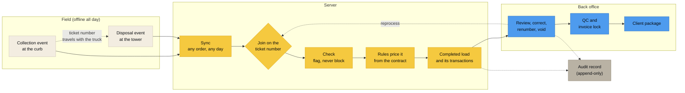
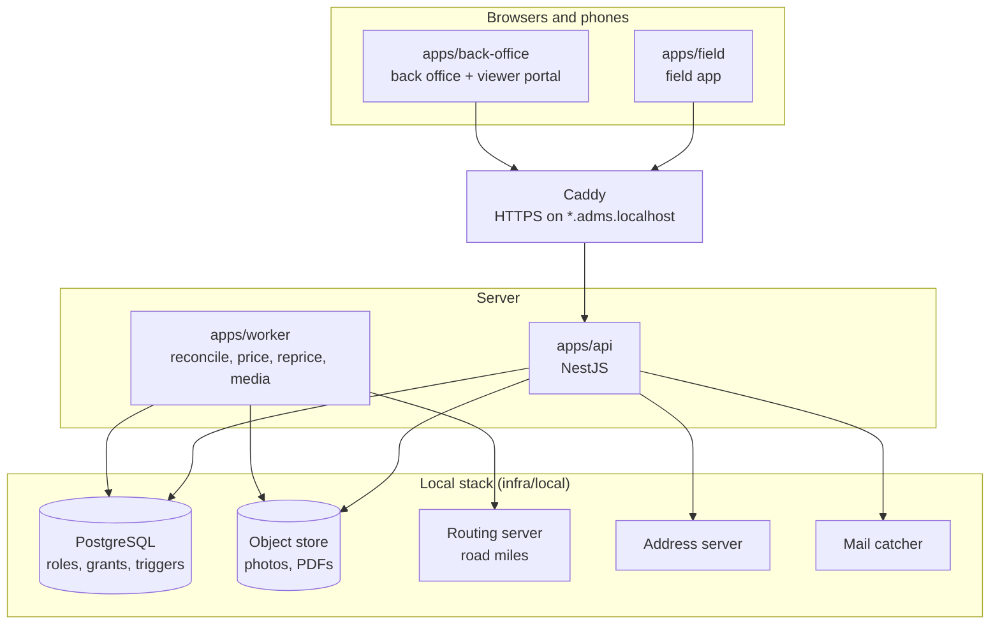

<div align="center">

# Open ADMS

**An open source Automated Debris Management System. Installed and run by the firm that uses it.**

[](LICENSE)
[](.nvmrc)
[](tsconfig.base.json)
[](infra/local/compose.yaml)
[](agent_store/CHAIN.md)
[](spec/ACCESSIBILITY-OFFICE.md)

**[Quick start](#quick-start) · [How it works](#how-it-works) · [What's in it](#whats-in-the-repository) · [Documentation](#documentation) · [Contributing](CONTRIBUTING.md) · [Security](SECURITY.md)**

</div>

---

Open ADMS is the system of record for a debris mission after a hurricane, flood, tornado or
wildfire: from the declaration to the audit. Field monitors record every load on phones that work
offline all day; the server joins what they recorded, prices it from the contract, flags whatever
disagrees, and keeps an audited ledger the firm's back office reviews, corrects and hands to the
client.

> [!NOTE]
> Debris records get read years after the work, by someone looking for a reason not to reimburse
> it. That one fact drives the design: nothing is deleted, every change is audited, and the
> properties that matter under audit are enforced by the database itself, not only by the code.

<br>

## Contents

| | |
|---|---|
| [The idea](#the-idea) | Two field events, two monitors, one ticket number |
| [Who it's for](#who-its-for) | The firm, its users, and the records it keeps |
| [Status](#status) | What's built today and what's next |
| [Quick start](#quick-start) | One command brings the whole system up locally, over HTTPS |
| [How it works](#how-it-works) | From setup to the client package, and the rules that never bend |
| [Architecture at a glance](#architecture-at-a-glance) | The apps, the packages and the local stack |
| [What's in the repository](#whats-in-the-repository) | Every app, package and tool, one line each |
| [Verification](#verification) | The chain, and what it proves |
| [Security](#security) | How it's secured, and how to report a weakness |
| [Documentation](#documentation) | The docs site and the spec |
| [Licence and credits](#licence-and-credits) | Apache-2.0, and who maintains this |

<br>

## The idea

**A truckload is recorded as two field events by two monitors who cannot see each other.** A
collection monitor at the curb records where the debris came from, what kind it is and when it was
loaded. A disposal monitor at the tower of the disposal site records how full the truck arrived
(the **load call**, a percentage of the container's certified capacity), where it dumped, and that
it left empty. Both record under **one ticket number**, which the truck carries from the curb to
the tower.

Neither monitor can make a billable load alone. **Only the server joins the two events**, by
their shared ticket number, and flags anything their independently captured facts disagree on.



The field events are the evidence. Everything else (the completed load, its status, its flags, its
zone and mileage, its transactions) is the system's conclusion from them, written by the worker
and drawn again whenever an event or the setup changes.

<br>

## Who it's for

A **firm**, usually a debris monitoring firm, installs Open ADMS and runs its **own
installation**. Its setup decides how everything plays out: names, codes, pick-lists, pay items and
rules are the firm's, with defaults tailored to debris work.

| Who | Signs in | Does |
|---|---|---|
| **Admin** | the back office, with two-step sign-in | everything, setup included |
| **Manager / analyst** | the back office, with two-step sign-in | what they're granted: review, correct, renumber, void, accept flags, QC, lock as invoiced |
| **Field monitor** | a Monitor ID (`M004127`) on an enrolled phone, offline from its login list | records field events on the day's assignment; never sees a rate or a code |
| **Read-only viewer** | the viewer portal | a client user, contractor user or auditor reading what they're allowed to |

Clients (the jurisdiction paying), declaration events, contractors, contracts, disposal sites and
property owners are **records** the firm keeps, not logins.

<br>

## Status

Open ADMS is pre-1.0. **The web platform is built** and comes up with one command.

| Part | Status |
|---|---|
| API, sync, reconciliation engine and worker | ✅ Built |
| Field app, browser build (enrolment, assignments, offline sign-in, every capture, certification, printing, sync and turn-in) | ✅ Built |
| Back office (project setup, people and phones, the dispatch board, the time clock, review and correct, the ledger, QC, invoice locks, audit trail, reports and exports) | ✅ Built |
| Read-only viewer portal | ✅ Built |
| One command to bring it all up locally, over HTTPS | ✅ Built (`pnpm start`) |
| The golden mission run through every screen to the approved numbers | ✅ Passing |
| Field app on iPhone and Android (native builds of the same app) | ⏳ Next |
| A hosted demo and a production install guide | ⏳ Later |

<br>

## Quick start

### What you need

| | |
|---|---|
| **Node 24** | through [fnm](https://github.com/Schniz/fnm); the version is pinned in `.nvmrc` |
| **pnpm 11** | through Corepack (`corepack enable`); the version is pinned in `package.json` |
| **Docker** | with Compose; the local stack runs Postgres, an object store, a mail catcher, a routing server, an address server and Caddy |
| **Disk and patience** | the first run downloads a public map extract and builds road tiles and an address index before the stack answers |

### Bring it up

```bash
git clone https://github.com/MrRyanAlexander/openadms.git
cd openadms
eval "$(fnm env --shell zsh)" && fnm use   # Node 24, from .nvmrc
corepack enable
pnpm install
pnpm start                                 # the installer, then the whole stack
```

`pnpm start` runs the installer, which asks four questions on a first run (the firm's name, what it
calls its ADMS, whether to send email through the local mail catcher, and the firm's **master
passcode**), then sets up the database, its roles and migrations. It then builds and starts
everything, offers the two sample projects, and prints where each part answers:

| Part | Address |
|---|---|
| Back office and viewer portal | `https://office.adms.localhost` |
| Field app (browser build) | `https://field.adms.localhost` |
| API | `https://api.adms.localhost` |

Every address is HTTPS, locally too. Trust the stack's own root certificate,
`infra/local/.generated/caddy-root.crt`, in your browser to open them.

<details>
<summary><b>The other commands you'll use</b></summary>
<br>

| Command | What it does |
|---|---|
| `pnpm installer:admin` | Makes the firm's first admin (or lets an admin back in) |
| `pnpm local:accounts` | Writes the dev stack's own accounts; `--show` lists them, `--codes` shows their two-step codes |
| `pnpm sample` | Loads the sample projects, if they weren't loaded at first run |
| `pnpm local:status` | Shows each container of the stack |
| `pnpm local:down` | Stops the stack, keeping its data |
| `pnpm local:wipe` | Removes the stack's data, its generated settings and certificates |
| `pnpm installer:check` | Checks the installation: settings, roles, migrations |
| `pnpm openapi` | Writes the API's OpenAPI description, `apps/api/openapi.json` |

</details>

> [!WARNING]
> The dev accounts and the sample projects exist to make the system explorable. Never use them on
> an installation that will hold a firm's real records.

<br>

## How it works

### A mission, end to end

| Step | Who | What happens |
|---|---|---|
| 1. **Set up** | back office | Client → declaration event → project; contracts; forms and debris types; pay items with a rate per prime; disposal sites; rules; certifications; ROEs. A setup check lists the gaps before the field day |
| 2. **Dispatch** | back office | Each phone is enrolled once. The dispatch board gives each monitor the day's **assignment**: one project, their work, one site if they work at one |
| 3. **Capture** | monitors, offline | Scan the badge, take the ticket number, record the event; a printed receipt. Sealed for the monitor once submitted |
| 4. **Sync** | the phone | Whenever there's signal, in any order. The only rejection is a duplicate number, quarantined in full for a person |
| 5. **Reconcile** | the worker | Group by ticket number, check, attach zone and mileage, run the firm's rules, write the completed record and its transactions |
| 6. **Review** | back office | One queue: correct any captured field in place, renumber real work, void what never happened, accept a flag that's right. Each one reprocesses the ticket |
| 7. **QC and lock** | back office | QC Review → Approved / Issues / Void, set by people; approved tickets lock as invoiced, optionally in a named batch |
| 8. **Client package** | back office | Tickets, photos, receipts and transactions from the exports (CSV, Excel-compatible, JSON, photo PDFs, the receipt batch) |

The same engine handles **loads** (a collection and a disposal), **haul-outs** from a staging site
to final disposal, **unit rate work** (hangers, leaners, stumps, white goods, crew time) and
**forms** (ROEs, surveys, incidents, citizen drop-off logs), including **split loads** gathered from
several properties.

### The rules that never bend

| Rule | What it means |
|---|---|
| **Flag, never block** | After setup nothing refuses field work. A problem gets a plain message: *"Ticket 101008: debris type mismatch. Flagged for review."* A ticket in review still bills |
| **Nothing is lost** | No hard deletes: records are archived, closed or voided. Every change writes an append-only audit record with a real actor |
| **Regenerated, never reversed** | Transactions always show the current truth. When a ticket changes they're drawn again; each removed row is first copied in full to the audit record |
| **Offline is normal** | Arrival order means nothing; events are ordered by field time. A ticket waiting for its other event never expires |
| **Monitors never see a rate or a code** | They pick by name. Rates live only on pay items, one per prime; the firm's rules create every transaction |
| **A certification certifies a container or a crew** | Never a vehicle. The cert number is the placard number is the badge number |
| **The firm decides** | Pick-lists are extendable, thresholds are settings, names follow the contract. As little as possible is hard-coded |

<br>

## Architecture at a glance

TypeScript end to end, with Prisma over PostgreSQL. Apps reach the server only through the API,
over HTTPS; rules shared by the phone and the server live once, in `packages/domain`.



Shared code lives in workspace packages, each with its own tests: `domain`, `contracts`, `db`,
`look`, `receipts` and `scenarios`. No app copies another's code or reaches inside it.

<br>

## What's in the repository

```
openadms/
├── apps/       the field app, the back office and portal, the API, the worker, the docs site
├── packages/   shared code: domain rules, payloads, the database, the look, receipts, scenarios
├── infra/      the local stack: Docker Compose, Caddy, Postgres, the map servers
├── tools/      the installer, the verification chain, the licence and security checks
└── spec/       how the system works: the parts, the architecture, data model, flags, lists
```

| Path | What it is |
|---|---|
| [`apps/api`](apps/api) | The API: device sync, the back office's and the portal's endpoints (NestJS) |
| [`apps/worker`](apps/worker) | Reconciliation, pricing, repricing and media jobs |
| [`apps/field`](apps/field) | The field app (React + Vite; native builds through Capacitor next) |
| [`apps/back-office`](apps/back-office) | The back office and the read-only viewer portal (React + Vite) |
| [`apps/docs`](apps/docs) | The documentation site (Astro Starlight) |
| [`packages/domain`](packages/domain) | The domain rules shared by phone and server; depends on no other workspace |
| [`packages/contracts`](packages/contracts) | Zod schemas for every API and sync payload |
| [`packages/db`](packages/db) | The Prisma schema, migrations, the database's hardening and seed data |
| [`packages/look`](packages/look) | The tokens, components (on React Aria), translation layer and accessibility test helpers every web app is built from |
| [`packages/receipts`](packages/receipts) | One receipt model, rendered to ZPL for Zebra printers and to PDF, with its Code 128 barcode |
| [`packages/scenarios`](packages/scenarios) | The scenario harness: 25 stories and the golden mission |
| [`infra/local`](infra/local) | The local HTTPS stack and `pnpm local:*` |
| [`tools/setup`](tools/setup) | The installer: the setup interview, secrets, roles, migrations, seed |
| [`tools/chain`](tools/chain) | The verification chain in one command |
| [`tools/licences`](tools/licences) · [`tools/security`](tools/security) | The licence check; the dependency audit, secrets scan and grant tests |

<br>

## Verification

```bash
pnpm chain                 # everything, in order, with one summary (about eleven minutes)
pnpm chain test scenarios  # only the steps named
pnpm test                  # typecheck, then every unit and integration test
pnpm scenarios             # every story; `pnpm scenarios golden-mission` for one
pnpm e2e                   # the field app's browser tests
pnpm lint                  # ESLint and Prettier
pnpm security              # dependency audit, secrets scan, env files, grant tests
pnpm licences              # every installed package's licence against the allowed list
```

The chain brings the stack up, checks the installation, then runs the typecheck, tests, stories,
browser tests, security checks, lint and licences. Its last recorded counts are in
[`agent_store/CHAIN.md`](agent_store/CHAIN.md): 3,883 tests in 239 files, 25 stories, and every
web screen checked for accessibility in light and dark.

**The golden mission** ([`spec/golden/MISSION.md`](spec/golden/MISSION.md)) is one worked mission
holding every kind of record. Run through the screens, it sets up two projects in the back office,
captures the field days on the field app, reviews, QCs and locks them, and the ledger must read the
approved totals to the cent.

<br>

## Security

Security is designed in at every layer ([`spec/ARCHITECTURE.md`](spec/ARCHITECTURE.md) §16,
[`spec/THREAT-MODEL.md`](spec/THREAT-MODEL.md)).

| | |
|---|---|
| **HTTPS everywhere** | Between every service, locally too; CORS by exact allow-list; strict page policies |
| **Sign-in** | NIST SP 800-63B: Argon2id password hashes, a breached-password list, two-step sign-in for the back office |
| **The database enforces its own rules** | Roles, grants, constraints and triggers, not only the code; the audit log is append-only |
| **Phones** | Enrolled once with the firm's master passcode; data on the phone encrypted |
| **Checked against** | OWASP ASVS 5.0 Level 2 for the API ([checklist](spec/CHECKLIST-API.md)); OWASP MASVS for the field app ([checklist](spec/CHECKLIST-FIELD.md)) |
| **Supply chain** | Exact versions only, nothing younger than seven days, no install scripts unless allowed by name, every advisory fails the audit |

Found a weakness? **Don't open a public issue.** Report it privately as [SECURITY.md](SECURITY.md)
describes.

<br>

## Documentation

| Where | Covers |
|---|---|
| [`apps/docs`](apps/docs) | The documentation site. Run it locally with `pnpm docs:dev` |
| [`spec/INDEX.md`](spec/INDEX.md) | **Start here** for the spec: what Open ADMS is, its parts in mission order, every document |
| [`spec/VISION.md`](spec/VISION.md) | What the finished system is and guarantees |
| [`spec/parts/`](spec/parts) | Each part, step by step: setup, people and devices, certification, capture, sync, reconciliation, pricing, review, invoicing |
| [`spec/ARCHITECTURE.md`](spec/ARCHITECTURE.md) | How every layer is built and secured |
| [`spec/DATA-MODEL.md`](spec/DATA-MODEL.md) · [`spec/FLAGS.md`](spec/FLAGS.md) · [`spec/LISTS.md`](spec/LISTS.md) | Every record's fields; every flag's code and wording; every pick-list |
| [`spec/RULES.md`](spec/RULES.md) · [`spec/RATE-SHEET.md`](spec/RATE-SHEET.md) | The rule builder; a real rate sheet set up line by line |
| [`spec/CONVENTIONS.md`](spec/CONVENTIONS.md) | Today's words and the example world every example comes from |
| [`apps/api/openapi.json`](apps/api/openapi.json) | The API's OpenAPI description |
| [`spec/ACCESSIBILITY-FIELD.md`](spec/ACCESSIBILITY-FIELD.md) · [`spec/ACCESSIBILITY-OFFICE.md`](spec/ACCESSIBILITY-OFFICE.md) | The WCAG 2.2 AA review of each app |

<br>

## Contributing

Field experience counts as much as code here. A monitor who can describe exactly why a load call
gets disputed is contributing something a developer cannot.

- [Contributing guide](CONTRIBUTING.md): the workspace, the conventions, the tests and what a good
  pull request looks like.
- [Report a bug](../../issues/new?template=bug_report.yml), [request a feature](../../issues/new?template=feature_request.yml)
  or [describe how a contract or a site really works](../../issues/new?template=field_practice.yml).
- [Code of conduct](CODE_OF_CONDUCT.md) and [security policy](SECURITY.md).

<br>

## Licence and credits

Released under the [Apache License 2.0](LICENSE); see [NOTICE](NOTICE). Use it, adapt it, run it
for your own firm, build services around it. Contributions come in under the same licence.

Maintained by [Ryan Price](https://github.com/MrRyanAlexander), a debris data manager with seven
years of recovery operations across multiple federal declarations, independent of any prime
contractor. Part of [OpenRecover](https://openrecover.com), a set of free, open tools for disaster
recovery data.

<div align="center">
<br>
<sub><b>Open data. Real recovery.</b></sub>
</div>
