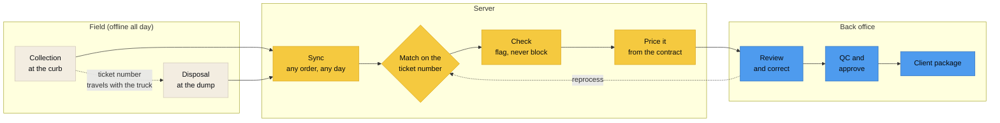
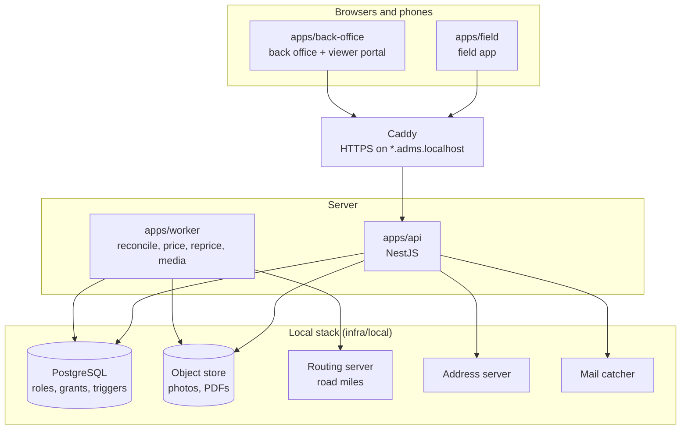

<div align="center">

# Open ADMS

**Free, open source debris management software for disaster recovery.<br>Your firm installs it, runs it and owns every record in it.**

[](LICENSE)
[](agent_store/CHAIN.md)
[](spec/ACCESSIBILITY-OFFICE.md)

**[Install it](#install-it-one-line) · [What it does](#what-it-does) · [How a mission runs](#how-a-mission-runs) · [Documentation](#documentation) · [Contributing](CONTRIBUTING.md) · [Security](SECURITY.md)**

</div>

---

## What it does

After a hurricane, flood, tornado or wildfire, every truckload of debris has to be counted,
checked and paid for, and years later an auditor will read the records looking for a reason not to
reimburse them. Open ADMS keeps those records straight.

- 📱 **Field monitors** record every load on a phone that works **offline all day**.
- 🔗 **The system** matches what the curb and the dump each recorded, prices it from the contract,
  and **flags anything that disagrees** for a person to look at.
- 🗂️ **The back office** reviews, corrects and approves, and hands the client a clean package.
- 🔒 **Nothing is ever deleted.** Every change is recorded with who made it and why.

<br>

## Install it: one line

Your IT person or engineer opens **Terminal** on the computer or server that will run it, clicks
the copy button on **one** of the boxes below, pastes it, and presses Enter.

### ⭐ Option 1: with the two demo projects (best for a first look)

```bash
git clone https://github.com/MrRyanAlexander/openadms.git && cd openadms && corepack enable && pnpm install && pnpm start
```

Comes with two made-up sample projects already full of tickets, forms and reviews, so you can click
around everything before setting up your own. Their names start with **"Sample:"**.

### Option 2: blank (for your real work)

```bash
git clone https://github.com/MrRyanAlexander/openadms.git && cd openadms && corepack enable && pnpm install && pnpm start:blank
```

An empty installation, ready for your firm's own clients, contracts and projects.

### Then

It asks **four questions**: your firm's name, what you call your ADMS, how to send email, and a
**master passcode** your monitors' phones will use. Then it sets everything up (the first run takes
a while; it downloads map data) and prints where to open it:

| Open | At |
|---|---|
| 🏢 **Back office** and viewer portal | `https://office.adms.localhost` |
| 📱 **Field app** | `https://field.adms.localhost` |

> [!IMPORTANT]
> **The computer needs two things first:** [Node.js 24](https://nodejs.org) and
> [Docker Desktop](https://www.docker.com/products/docker-desktop/). Both are free installers.

> [!WARNING]
> Keep demo and real work apart. Use **Option 2** for an installation that will hold a firm's real
> records.

<details>
<summary><b>⚙️ Advanced setup</b> (step by step, test runs, every command)</summary>
<br>

#### Step by step

```bash
git clone https://github.com/MrRyanAlexander/openadms.git
cd openadms
eval "$(fnm env --shell zsh)" && fnm use   # Node 24, pinned in .nvmrc (or install Node 24 any way you like)
corepack enable                            # pnpm, pinned in package.json
pnpm install
pnpm start                                 # the installer, then the whole stack (pnpm start:blank for no demo)
```

The installer asks its four questions on a first run, sets up the database, its roles and
migrations, then builds and starts everything. A rerun re-checks what it knows and never remakes a
secret. Answers can also come one per line on standard input, for a scripted install.

#### Your browser and the certificate

Every address is HTTPS, locally too. Trust the stack's own root certificate,
`infra/local/.generated/caddy-root.crt`, in your browser or system keychain to open them without a
warning. The API answers at `https://api.adms.localhost`.

#### Every command

| Command | What it does |
|---|---|
| `pnpm start` | Installs (first run), then brings the whole stack up, with the demo projects |
| `pnpm start:blank` | The same, without the demo projects |
| `pnpm installer:admin` | Makes the firm's first admin (or lets an admin back in) |
| `pnpm sample` | Loads the demo projects later, into an installation that doesn't have them |
| `pnpm local:up` | Brings the stack up again, after it was stopped |
| `pnpm local:status` | Shows each container of the stack |
| `pnpm local:down` | Stops the stack, keeping its data |
| `pnpm local:wipe` | Removes the stack's data, its generated settings and certificates |
| `pnpm installer:check` | Checks the installation: settings, roles, migrations |
| `pnpm installer:teardown` | Drops the database and its logins and removes the settings |
| `pnpm local:accounts` | Writes the dev stack's own test accounts; `--show` lists them, `--codes` shows their two-step codes |
| `pnpm openapi` | Writes the API's OpenAPI description, `apps/api/openapi.json` |
| `pnpm docs:dev` | Runs the documentation site locally |

#### Test runs

```bash
pnpm chain                 # everything, in order, with one summary (about eleven minutes)
pnpm chain test scenarios  # only the steps named
pnpm test                  # typecheck, then every unit and integration test
pnpm scenarios             # every story; `pnpm scenarios golden-mission` for one
pnpm sample --try          # loads the demo into a throwaway database, to see it done, then drops it
pnpm e2e                   # the field app's browser tests
pnpm lint                  # ESLint and Prettier
pnpm security              # dependency audit, secrets scan, env files, grant tests
pnpm licences              # every installed package's licence against the allowed list
```

The chain brings the stack up, checks the installation, then runs the typecheck, tests, stories,
browser tests, security checks, lint and licences. Its last recorded counts are in
[`agent_store/CHAIN.md`](agent_store/CHAIN.md). **The golden mission**
([`spec/golden/MISSION.md`](spec/golden/MISSION.md)) runs one worked mission through every screen,
and the ledger must read the approved totals to the cent.

#### What the stack runs

Docker Compose ([`infra/local/compose.yaml`](infra/local/compose.yaml)) runs PostgreSQL 18, an
object store for photos and PDFs, a mail catcher, a routing server for road miles, an address
server and Caddy for HTTPS, plus the API and the worker.

</details>

<br>

## Who uses it

A **firm**, usually a debris monitoring firm, installs Open ADMS and runs its **own installation**.
Its setup decides how everything plays out: names, codes, pick-lists, pay items and rules are the
firm's, with defaults tailored to debris work.

| Who | Signs in | Does |
|---|---|---|
| **Admin** | the back office, with two-step sign-in | everything, setup included |
| **Manager / analyst** | the back office, with two-step sign-in | what they're granted: review, correct, renumber, void, QC, lock as invoiced |
| **Field monitor** | a Monitor ID on an enrolled phone, offline too | records the day's work; never sees a rate or a code |
| **Read-only viewer** | the viewer portal | a client, contractor or auditor reading what they're allowed to |

Clients, contractors, contracts, disposal sites and property owners are **records** the firm keeps,
not logins.

<br>

## How a mission runs

**Every truckload is recorded twice, by two monitors who can't see each other.** One at the curb
records where the debris came from; one at the dump records how full the truck arrived. Both use
the same **ticket number**, which travels with the truck. Only the server puts the two together, so
neither monitor alone can make a billable load.



| Step | Who | What happens |
|---|---|---|
| 1. **Set up** | back office | Client, declaration event and project; contracts, pay items and rates; disposal sites; rules; certifications; ROEs. A setup check lists the gaps before the field day |
| 2. **Dispatch** | back office | Each phone is enrolled once. The dispatch board gives each monitor the day's **assignment** |
| 3. **Capture** | monitors, offline | Scan the badge, take the ticket number, record the load; print a receipt |
| 4. **Sync** | the phone | Whenever there's signal, in any order |
| 5. **Reconcile** | the system | Match by ticket number, check, add zone and mileage, price from the firm's rules |
| 6. **Review** | back office | One queue: correct, renumber real work, void what never happened, accept a flag that's right |
| 7. **QC and lock** | back office | Approve, then lock as invoiced |
| 8. **Client package** | back office | Tickets, photos, receipts and transactions, exported (CSV, Excel, JSON, photo PDFs) |

The same system handles **loads**, **haul-outs** from a staging site to final disposal, **unit rate
work** (hangers, leaners, stumps, white goods, crew time), **forms** (ROEs, surveys, incidents,
citizen drop-off logs) and **split loads** gathered from several properties.

<details>
<summary><b>The rules that never bend</b></summary>
<br>

| Rule | What it means |
|---|---|
| **Flag, never block** | Nothing refuses field work. A problem gets a plain message: *"Ticket 101008: debris type mismatch. Flagged for review."* A ticket in review still bills |
| **Nothing is lost** | No deletes: records are archived, closed or voided. Every change is audited, with who made it |
| **Always the current truth** | When a ticket changes, its transactions are drawn again; every removed row is kept in the audit record first |
| **Offline is normal** | Arrival order means nothing. A ticket waiting for its other half never expires |
| **Monitors never see a rate or a code** | They pick by name. Rates live only on the pay items, one per prime |
| **A certification certifies a container or a crew** | Never a vehicle. The cert number is the placard number is the badge number |
| **The firm decides** | Pick-lists are extendable, thresholds are settings, names follow the contract |

</details>

<br>

## Status

Open ADMS is pre-1.0. **The web platform is built** and comes up with one command.

| Part | Status |
|---|---|
| Field app in the browser (enrolment, assignments, offline sign-in, every capture, printing, sync) | ✅ Built |
| Back office (setup, people and phones, dispatch, time clock, review, ledger, QC, invoicing, audit trail, reports and exports) | ✅ Built |
| Read-only viewer portal | ✅ Built |
| The engine: sync, matching, checks and pricing | ✅ Built |
| One command to set it all up | ✅ Built |
| Field app on iPhone and Android | ⏳ Next |
| A hosted demo and a production install guide | ⏳ Later |

<br>

## Security

Security is designed in at every layer: HTTPS everywhere (locally too), two-step sign-in for the
back office, passwords handled to NIST SP 800-63B, encrypted phones, an append-only audit log, and
a database that enforces its own rules. Checked against OWASP ASVS Level 2
([API checklist](spec/CHECKLIST-API.md)) and OWASP MASVS ([field app checklist](spec/CHECKLIST-FIELD.md)).

Found a weakness? **Don't open a public issue.** Report it privately as [SECURITY.md](SECURITY.md)
describes.

<br>

## For engineers

<details>
<summary><b>Architecture</b></summary>
<br>

TypeScript end to end, with Prisma over PostgreSQL. Apps reach the server only through the API,
over HTTPS; rules shared by the phone and the server live once, in `packages/domain`.



The field events are the evidence. Everything else (the completed load, its status, flags, zone,
mileage and transactions) is the system's conclusion from them, written by the worker and drawn
again whenever an event or the setup changes.

</details>

<details>
<summary><b>What's in the repository</b></summary>
<br>

| Path | What it is |
|---|---|
| [`apps/api`](apps/api) | The API: device sync, the back office's and the portal's endpoints (NestJS) |
| [`apps/worker`](apps/worker) | Reconciliation, pricing, repricing and media jobs |
| [`apps/field`](apps/field) | The field app (React + Vite; native builds through Capacitor next) |
| [`apps/back-office`](apps/back-office) | The back office and the read-only viewer portal (React + Vite) |
| [`apps/docs`](apps/docs) | The documentation site (Astro Starlight) |
| [`packages/domain`](packages/domain) | The domain rules shared by phone and server |
| [`packages/contracts`](packages/contracts) | Zod schemas for every API and sync payload |
| [`packages/db`](packages/db) | The Prisma schema, migrations, the database's hardening and seed data |
| [`packages/look`](packages/look) | Tokens, components (on React Aria), translation and accessibility helpers |
| [`packages/receipts`](packages/receipts) | One receipt model, rendered to ZPL for Zebra printers and to PDF |
| [`packages/scenarios`](packages/scenarios) | The scenario harness: 25 stories, the golden mission and the demo projects |
| [`infra/local`](infra/local) | The local HTTPS stack and `pnpm local:*` |
| [`tools/setup`](tools/setup) | The installer: the setup questions, secrets, roles, migrations, seed |
| [`tools/chain`](tools/chain) | The verification chain in one command |
| [`tools/licences`](tools/licences) · [`tools/security`](tools/security) | The licence check; the dependency audit, secrets scan and grant tests |

</details>

<br>

## Documentation

| Where | Covers |
|---|---|
| [`apps/docs`](apps/docs) | The documentation site (`pnpm docs:dev`) |
| [`spec/INDEX.md`](spec/INDEX.md) | **Start here** for the spec: what Open ADMS is, its parts in mission order |
| [`spec/VISION.md`](spec/VISION.md) | What the finished system is and guarantees |
| [`spec/parts/`](spec/parts) | Each part, step by step |
| [`spec/ARCHITECTURE.md`](spec/ARCHITECTURE.md) | How every layer is built and secured |
| [`spec/DATA-MODEL.md`](spec/DATA-MODEL.md) · [`spec/FLAGS.md`](spec/FLAGS.md) · [`spec/LISTS.md`](spec/LISTS.md) | Every record's fields; every flag's wording; every pick-list |
| [`spec/RULES.md`](spec/RULES.md) · [`spec/RATE-SHEET.md`](spec/RATE-SHEET.md) | The rule builder; a real rate sheet set up line by line |

<br>

## Contributing

Field experience counts as much as code here. A monitor who can describe exactly why a load call
gets disputed is contributing something a developer cannot.

- [Contributing guide](CONTRIBUTING.md)
- [Report a bug](../../issues/new?template=bug_report.yml), [request a feature](../../issues/new?template=feature_request.yml)
  or [describe how a contract or a site really works](../../issues/new?template=field_practice.yml)
- [Code of conduct](CODE_OF_CONDUCT.md) and [security policy](SECURITY.md)

<br>

## Licence and credits

Released under the [Apache License 2.0](LICENSE); see [NOTICE](NOTICE). Use it, adapt it, run it
for your own firm, build services around it.

Maintained by [Ryan Price](https://github.com/MrRyanAlexander), a debris data manager with seven
years of recovery operations across multiple federal declarations, independent of any prime
contractor. Part of [OpenRecover](https://openrecover.com), a set of free, open tools for disaster
recovery data.

<div align="center">
<br>
<sub><b>Open data. Real recovery.</b></sub>
</div>
